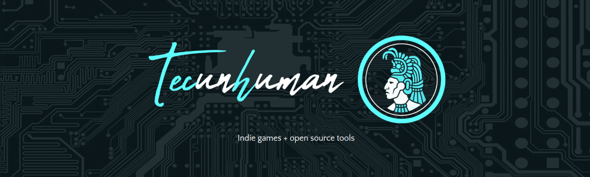
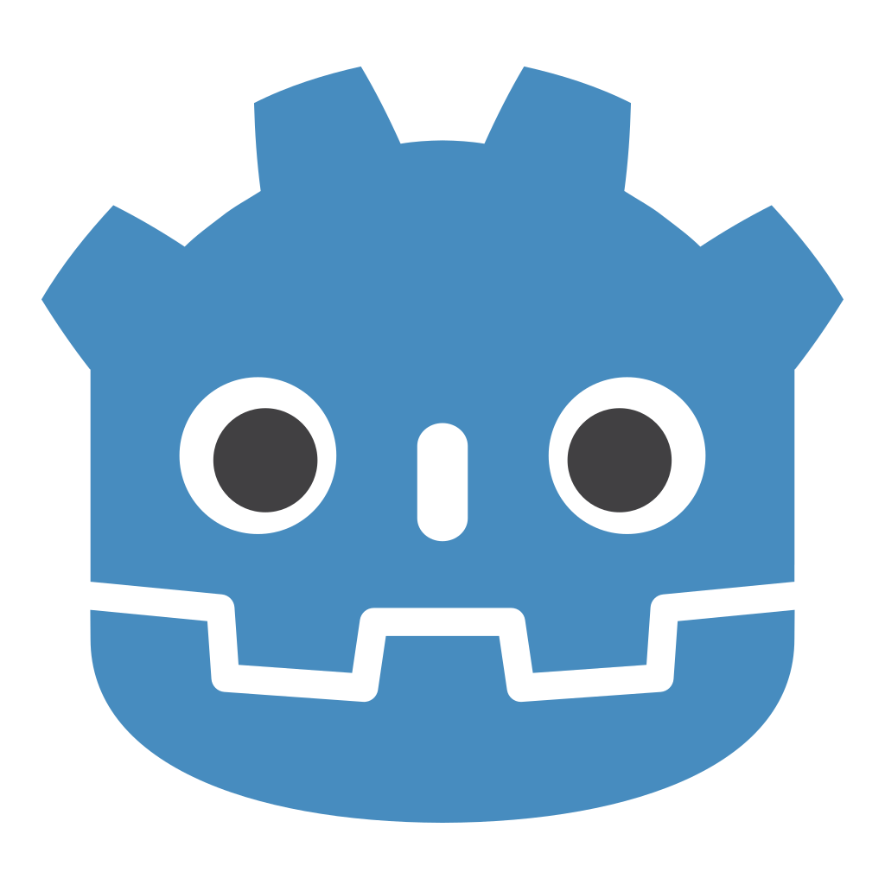
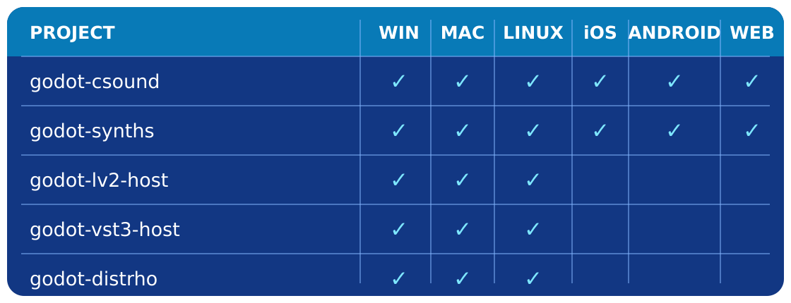
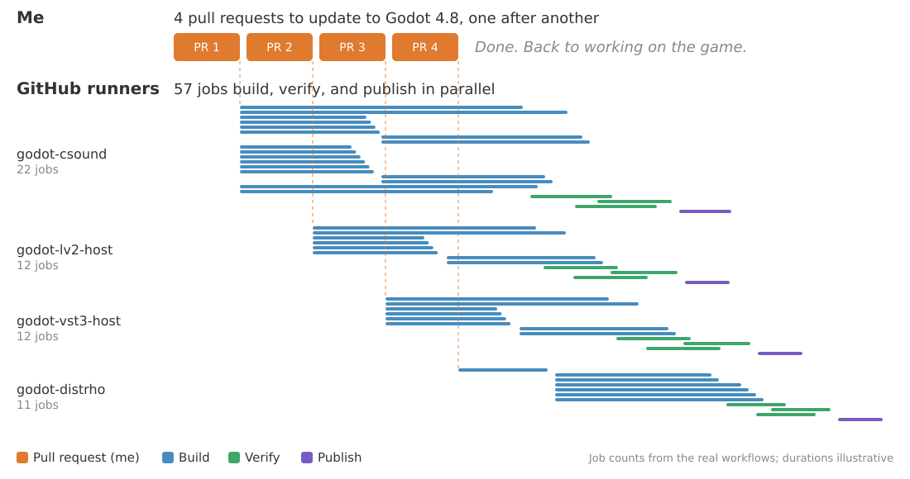
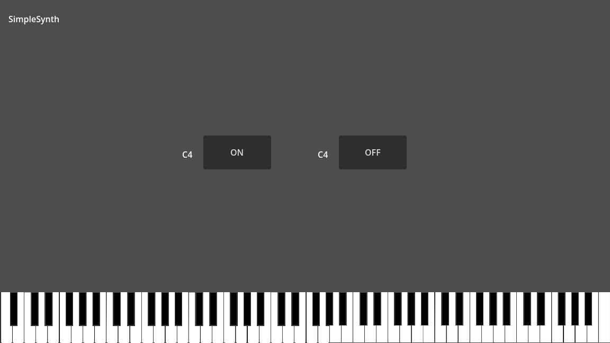
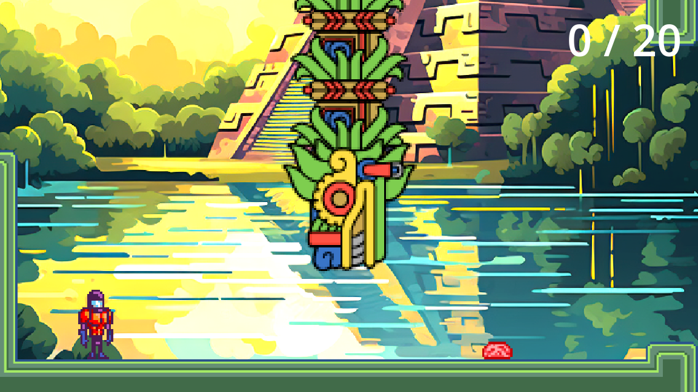
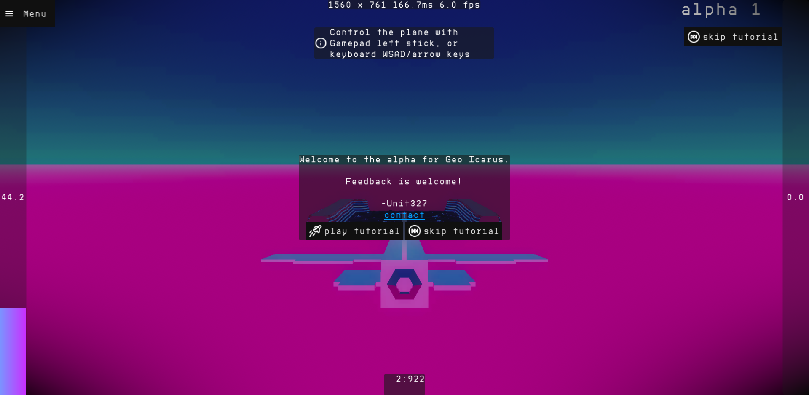
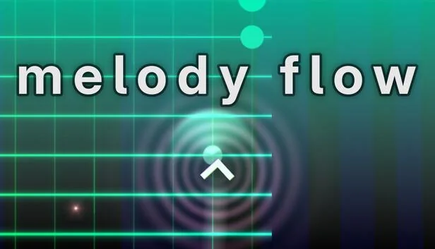
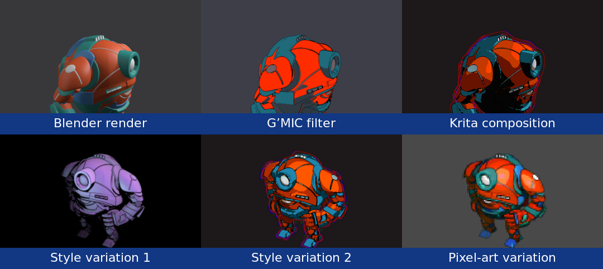
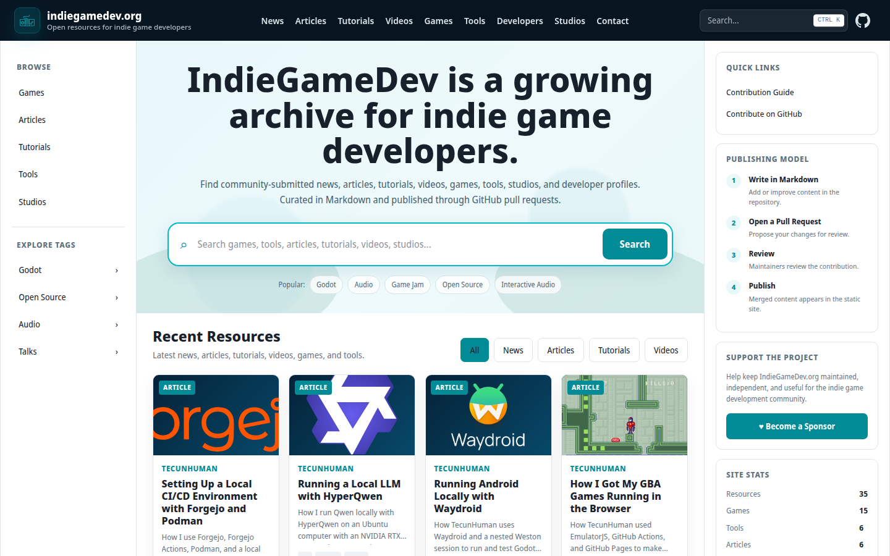

# Small Team, Big Leverage: Using Automation to Build Games Faster

---

# Hi, I'm Werner

I'm a full-time **indie game developer, software engineer, artist, and musician**.

I've been a hobbyist indie game developer for over 20 years, and I have professional experience as a software engineer building and maintaining microservices at scale.

I created and maintain **godot-csound**, **godot-lv2-host**, **godot-vst3-host**, and **godot-distrho**. These are open-source projects for real-time audio synthesis, plugin hosting, and interactive audio in **Godot**.

I'm currently working on my first commercial game release.

---

## Building leverage

How I built leverage as a solo developer, in three different ways:

1. **Integrate existing ecosystems:** reuse libraries and tools instead of rebuilding. Godot can synthesize audio, create plugins, and use thousands of existing ones.
2. **Automate:** avoid repetitive manual work and free up time for the game. Turn repetitive build, art, and music workflows into automated systems.
3. **Move up the stack:** make tools easier to use, so development takes less time. Build audio plugins in GDScript without low-level programming, compilation, or build systems.

# Presenter Notes

This is the map for the talk. Most of the time goes to automation, because that is where most of my leverage came from. Integrating existing ecosystems is how the story starts, and moving up the stack is where it leads.

---

## I wanted dynamic music in my game

For the game I am building, I wanted music that could react to the player, the world, and the story. I did not begin with a complete architecture; I followed the problem one step at a time:

1. I started with **FluidSynth** to play MIDI using SoundFonts.
2. I integrated **Csound** when I needed more control over synthesis and sequencing.
3. I began creating instruments in Csound for the sounds my game needed.
4. I built **godot-distrho** to export them as audio plugins and allow musicians to use the same audio engine in their DAWs.

Once Godot could build plugins, it felt natural to host them too, and the idea of loading any plugin came up.

---

## I didn't need to build every instrument

The music-production ecosystem already had thousands of mature synthesizers and effects.
Instead of recreating them in Csound, I could make **Godot host the plugins people already use**. That led to:

* **godot-lv2-host** for LV2 plugins
* **godot-vst3-host** for VST3 plugins

The highest-leverage solution was not another instrument. It was a bridge to an ecosystem: every compatible plugin became an instrument or effect I could use instead of building myself.

---

## The first integration created a reusable path

Each library has its own build system, dependencies, and platform-specific problems. After solving the first integration, I could reuse the code, knowledge, and methodology, making each later project faster to build and support.

---

## The fastest work is work no one has to do

Working faster makes a task cheaper. 
Automation makes it disappear.

Creating the automation took real upfront work. Today, a pull request starts a pipeline that builds, tests, packages, and publishes every supported target, with no human in the loop.

That time comes back on every release, on every project, for as long as the system runs. **That is leverage: it keeps paying after you stop working.**

# Presenter Notes

Every supported combination must be configured, built, tested, packaged, and published. Repeating that manually across every project and platform would be impractical for one developer and difficult for a team to maintain. I applied practices I learned at large companies: reproducible environments, continuous integration, automated validation, and versioned releases.

---

## Four pull requests. Fifty-seven jobs.

# Presenter Notes

Updating to Godot 4.8 meant one small pull request per project, done one after another. Each pull request starts the same workflows: 57 jobs across the four repositories build every platform, verify the extension in Godot, and publish the release, all in parallel. My part ends when the pull request is open.

For scale: the real Godot 4.7 update on July 4, 2026 used 15.7 hours of runner time across those 57 jobs.

---

## Insight: small teams can create leverage

1. **Use leverage:** Build on existing tools, libraries, platforms, and knowledge.
2. **Build leverage:** Turn what you learn and repeat into reusable code, documented processes, and automation.
3. **Share leverage:** Package and publish your work so someone else can start where you finished.

The cycle compounds. Shared work becomes the foundation for the next person, project, or tool.

This is how I applied all three as one indie developer.

---

## Use leverage by building on a shared stack

Large companies do not build products from scratch. They combine shared, proven layers, and I applied the same approach:

* **Engine interface:** Godot and GDExtension
* **Audio ecosystems:** Csound, Lilv and LV2, VST3 SDK, and DISTRHO
* **Cross-platform builds:** Scons, CMake, vcpkg, MinGW, and osxcross
* **Reproducible automation:** Docker and GitHub Actions

The advantage is not owning every layer. It is knowing **what to reuse, what to standardize, and where custom work creates unique value**.

# Presenter Notes

At the large companies where I worked, teams combined operating systems, containers, languages, runtimes, libraries, databases, build tools, package systems, and testing, deployment, and monitoring tools. Because teams shared tools and methodologies, improvements to the stack created leverage across many people, services, and future projects.

My custom work is the layer that connects these systems to Godot, then builds, tests, packages, and releases that connection reliably. I did not need to recreate the engine, audio libraries, compilers, or automation platform.

---

## Build leverage by turning repetition into a system

1. **Notice:** Find repeated work, friction, or failure.
2. **Describe:** Write the task as explicit steps and rules.
3. **Execute:** Turn those steps into code or a script.
4. **Reproduce:** Control the environment, inputs, and outputs.
5. **Automate:** Trigger the process without manual intervention.
6. **Share:** Package and document it so others can reuse it.

Each step reduces the amount of knowledge and effort that **must remain in one person's head**.

# Presenter Notes

The leverage is both reusable code and understanding. A large part of the build and release system carries into the next project, while experience helps me avoid solving the same problems again.

---

## Notice: what work keeps repeating?

As the projects and platforms multiplied, the same work kept returning:

* Install and configure the development environment for each target platform.
* Build each upstream library for every operating system and architecture.
* Configure and compile the Godot extension against that library.
* Test the integration on the target platform.
* Package the files in the structure Godot expects.
* Publish compatible, versioned releases.

Every new project began with similar problems, and every manual process risked inconsistent results. 
**If work repeats or must be performed exactly, it is a candidate for automation.**

# Presenter Notes

These are the steps I used to do by hand for every library, platform, and release. Each one is a chance to forget something or get a slightly different result.

---

## Describe: make the process explicit

Before automating the work, define what the process needs:

* **Inputs:** Library version, Godot version, target platform, CPU architecture, and build configuration
* **Steps:** Install the environment, build the library, compile the extension, test it, and package it
* **Outputs:** A versioned artifact with the files and directory structure Godot expects
* **Success criteria:** The build completes, the extension loads, the tests pass, and the package is ready to publish

**A process must be understood before it can be automated reliably.**

# Presenter Notes

Writing the process down exposes missing steps, hidden assumptions, and work that only exists in one person's memory.

---

## Execute: turn the process into code

Replace instructions with commands that perform the work:

* Platform scripts produce the debug and release builds.
* **vcpkg** and **CMake** build the library and dependencies; **SCons** builds the Godot extension.
* The scripts encode architectures, compiler options, and packaging steps.
* The **Makefile** provides consistent local entry points such as `make ubuntu`, `make mingw`, and `make osxcross`.

Instead of remembering every step, I run one Make target. The scripts become reusable code and the source of truth for local and automated builds.

---

## Code example: platform build script

    !bash
		#!/bin/bash
		# file: ./platform/ubuntu/build_release.sh

		dir=$(realpath .)
		src_dir=$dir/modules/csound
		build_dir=$src_dir/build/linux/release

		mkdir -p $build_dir
		cd $build_dir

		cmake -DCUSTOM_CMAKE=$src_dir/platform/linux/custom.cmake \
			-DCMAKE_INSTALL_PREFIX:PATH=$dir/addons/csound/bin/linux/release \
			-DCMAKE_BUILD_TYPE=Release \
			$src_dir

		make
		make install

		cd $dir
		scons platform=linux target=template_release

---

## Reproduce: control the environment

Containers make the scripts independent of one development machine:

* A **Docker image** packages the compiler, SDK, build tools, dependencies, and environment for each target.
* A Linux host can build Ubuntu, Windows with MinGW, macOS with osxcross, iOS with ioscross, Android, and Web targets.
* Make mounts the same source into each container and runs the same platform scripts.
* Shared images keep local builds and GitHub Actions in the same environment.
* Monthly rebuilds keep dependencies current; CI catches breakage early.

**Same source + same script + same environment = reproducible build**

---

## Code example: reproducible Docker image

    !bash
        # file: godot-build-containers/platform/ubuntu/Dockerfile
        FROM registry.gitlab.steamos.cloud/steamrt/steamrt4/sdk AS base-image

        RUN apt update -y && apt install -y build-essential \
            cmake \
            git \
            python3 \
            python3-pip \
            zip \
            curl \
            unzip \
            pkg-config \
            autoconf \
            libtool \
            flex \
            bison

        FROM registry.gitlab.steamos.cloud/steamrt/steamrt4/sdk
        COPY --from=base-image / /

        # file: godot-csound/platform/ubuntu/Dockerfile
        FROM ghcr.io/nonameentername/godot-ubuntu

---

## Code example: run the build in Docker

    !makefile
		# file: ./Makefile

		all: ubuntu mingw osxcross

		docker-ubuntu:
			docker build -t godot-csound-ubuntu ./platform/ubuntu

		shell-ubuntu: docker-ubuntu
			docker run -it --rm -v ${CURDIR}:${CURDIR} -w ${CURDIR} godot-csound-ubuntu ${SHELL_COMMAND}

		ubuntu: ubuntu-debug ubuntu-release

		ubuntu-debug:
			$(MAKE) shell-ubuntu SHELL_COMMAND='./platform/ubuntu/build_debug.sh'

		ubuntu-release:
			$(MAKE) shell-ubuntu SHELL_COMMAND='./platform/ubuntu/build_release.sh'

---

## Automate: remove the manual trigger

GitHub Actions becomes the operator of the reproducible process:

* A pull request or change to `main` starts the workflow.
* Parallel jobs run the same containers and scripts for each platform, architecture, and build type.
* Linux, macOS, and Windows jobs launch Godot headlessly and verify the integration produces the expected result.
* Build artifacts are collected only after their required jobs succeed.
* A successful change on `main` creates a versioned archive and publishes a GitHub release.

Local builds and CI use the same build logic. Automation changes **when** it runs, not **how** it runs.

---

## Code example: GitHub Actions runs the same build

    !yaml
        # file: .github/workflows/builds.yml
        jobs:
          linux-build:
            name: Linux/Ubuntu build
            runs-on: ubuntu-latest
            env:
              VERSION: v1
            steps:
              - name: Build godot-csound (Release)
                uses: nonameentername/docker-run-action@v3
                with:
                  image: ghcr.io/nonameentername/godot-csound-ubuntu:${{ env.VERSION }}
                  options: >-
                    -v ${{ github.workspace }}:${{ github.workspace }}
                    --workdir ${{ github.workspace }}
                  run: |
                    ./platform/ubuntu/build_release.sh

---

## Validation: a build is not finished until it runs

    !yaml
		# file: ./.github/workflows/builds.yml
		jobs:
		  verify-linux-build:
			name: Verify Linux/Ubuntu build
			runs-on: ubuntu-latest
			needs: linux-build
			steps:
			  - name: Setup Godot
				uses: chickensoft-games/setup-godot@v2
				with:
				  version: 4.7.0
				  use-dotnet: false
				  include-templates: false

			  - name: Godot import
				# First import registers the extension; assets can't load yet
				continue-on-error: true
				run: |
				  godot --headless --import

			  - name: Verify godot-csound
				run: |
				  godot --headless -s csound_run_scene.gd --quit-after 300 2> /dev/null \
				    | grep 'output result is 4'

---

## Automation can run locally too

The **TecunHuman workspace** packages a GitHub-like development stack that I can run locally:

* **Forgejo** provides local Git hosting, while **Python scripts** create its organizations and repositories.
* An **Actions runner** executes automated workflows.
* Shared **build containers** provide cross-platform Godot environments, with an example project demonstrating adoption.
* **rsync backups** preserve the repositories and development infrastructure.

A new project can inherit source control, automated builds, runners, and development environments instead of assembling them again. 
**The development platform becomes reusable leverage.**

---

## Share: make your leverage reusable

Sharing means removing integration work for the next developer:

* Versioned packages provide prebuilt GDExtensions for every supported platform.
* Documentation and examples explain how to use the integration without understanding its internals.
* Container images and build scripts preserve how the binaries were produced.
* Open source provides a working reference, similar to joining a large company and gaining access to its existing codebase.

Developers can use Csound and existing audio plugins without repeating the engine integration or cross-platform build work. 
**Solve it once, share it, and it becomes leverage in someone else's stack.**

---

## Install every addon with one command

**godot-package** is a lightweight GDScript dependency manager. Each project pins an exact GitHub release tag for every addon, then one headless command installs the same versions locally and in automation.

    !gdscript
		# file: quetzalcoatl/package.gd
        extends "res://addons/godot-package/package.gd"

        func _requirements():
            dependency("nonameentername/godot-csound", {"tag": "v0.1.0-beta.188"})
            dependency("nonameentername/godot-lv2-host", {"tag": "v0.1.0-beta.9"})
            dependency("nonameentername/godot-vst3-host", {"tag": "v0.1.0-beta.10"})

Install dependencies:

    !bash
        godot --headless -s package.gd install

---

## Move up the stack: plugins made in Godot

With the audio integration work completed, automated, and packaged, developers can build at a higher level. Tools like **Cabbage** turn Csound code into audio plugins. **godot&#8209;distrho** lets Godot developers do the same with skills they have:

* Build the instrument with GDScript, Godot scenes, and Csound.
* Install godot-distrho with godot-package. Prebuilt plugin templates come from its CI releases.
* Export **LV2** or **VST3** plugins for Linux and Windows, just like exporting a game.

**No C++, no plugin SDK, no compilers. Just Godot.**

# Presenter Notes

Key point: the CI pipelines from earlier build the plugin templates, so the plugin author never needs compilers or SDKs. The automation is what makes moving up the stack possible.

Demo: godot-distrho-example, the synth in the screenshot. Change the script, export, and load the plugin in a host.

---

## Shared leverage in real games

<strong>Quetzalcoatl</strong> Game jam entry Dynamic audio in one week

<strong>Geo Icarus</strong>

<strong>Melody Flow</strong>

# Presenter Notes

Introduce the games here; the demos follow. The dynamic music reacting to gameplay is the payoff for the problem from the start of the talk.

Quetzalcoatl was a one-week game jam entry. Dynamic audio fit into a jam schedule only because the integration, builds, and releases already existed. That is leverage compounding.

---

## Demo: Quetzalcoatl

<iframe class="video_embed" src="https://www.youtube-nocookie.com/embed/zt7ODFeZgnQ?start=60&end=106&rel=0" title="Quetzalcoatl – Godot Game Jam Gameplay" allow="autoplay; encrypted-media; picture-in-picture; fullscreen" allowfullscreen referrerpolicy="strict-origin-when-cross-origin"></iframe>

# Presenter Notes

Plays 1:00–1:46 of the gameplay video. Point out the music reacting to the game: built in one week because the audio integration already existed.

Fallback link: https://www.youtube.com/watch?v=zt7ODFeZgnQ&t=60

---

## Demo: Melody Flow

<iframe class="video_embed" src="https://www.youtube-nocookie.com/embed/55_PRX7sZ94?rel=0" title="Melody Flow Trailer" allow="autoplay; encrypted-media; picture-in-picture; fullscreen" allowfullscreen referrerpolicy="strict-origin-when-cross-origin"></iframe>

# Presenter Notes

Press play on the embedded trailer. Fallback link: https://www.youtube.com/watch?v=55_PRX7sZ94

Have the video open in a browser tab before the talk in case the venue network is slow.

---

## Future work: extending automation into art

**The tools change, but the process remains: notice, describe, execute, reproduce, automate, and share.**

This prototype is inspired by the **Dead Cells** 3D-to-2D workflow, adapted to use reusable **Krita documents** and **Python scripts** for composition and export:

* **Blender** imports an FBX and renders animation, depth, and normal passes.
* **G’MIC** applies repeatable stylization filters to every frame.
* **Krita** composites those passes through reusable layer templates.
* **Make and containers** run each stage with controlled tools and versions.

**One animated 3D asset > one consistent 30-frame 2D sequence**

# Presenter Notes

The same methodology applies anywhere work repeats. Procedural audio produces sounds and music from code, rules, and parameters; the same approach can generate art, levels, animation, and other game content. Reusable tools let your strongest skills compensate for limited time or weaker skills.

---

## Prototype: from 3D render to styled output

---

## Every tool we share makes the next game easier to build

* **Integrate:** Start with shared programs and knowledge such as Godot, Blender, Krita, libraries, and existing workflows.
* **Automate:** Separate reusable game functionality from project-specific code, then encode the development environment and process.
* **Move up the stack:** Publish addons, tools, containers, CI workflows, documentation, and examples so the next developer starts higher up the stack.

Large companies build shared internal platforms. Cloud and open-source communities extend this idea through reusable Terraform modules, Ansible collections, container images, and CI actions. 
**The indie game community can build its own shared stack in the same way.**

---

## Share your work on indiegamedev.org

# Presenter Notes

indiegamedev.org is intended to become an open archive connecting the work and knowledge of indie game developers: games and reusable tools, articles, tutorials, and videos, and developer and studio profiles.

Today, the archive contains only my own contributions. I am building the structure and contribution workflow first (Markdown, pull request, review, publish) so other developers and studios can add their work later.

Sharing code creates leverage. Sharing the knowledge and community around it makes that leverage easier to find and use.

---

# Questions?

* **Slides:** nonameentername.github.io/presentations/godotfest-2026/
* **Projects:** github.com/nonameentername
* **Workspace:** github.com/tecunhuman/workspace
* **Community archive:** indiegamedev.org
* **Studio and contact:** tecunhuman.com

